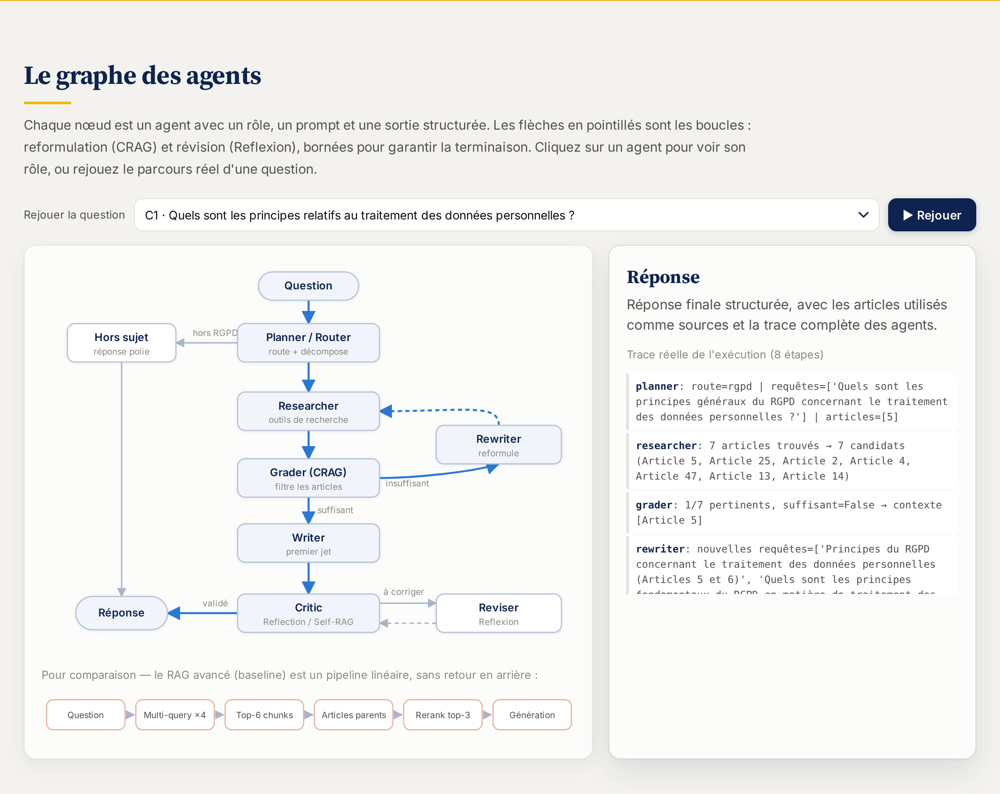
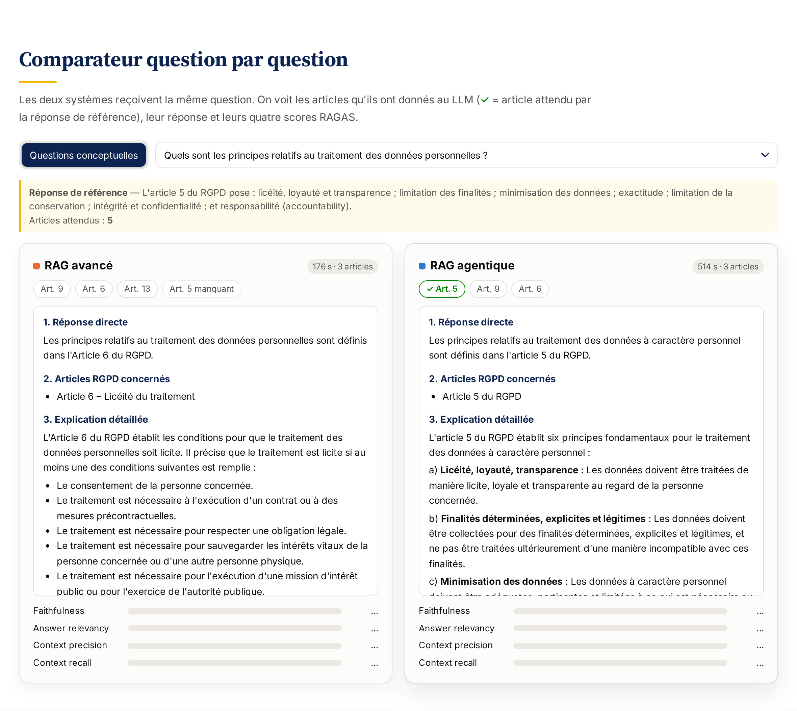
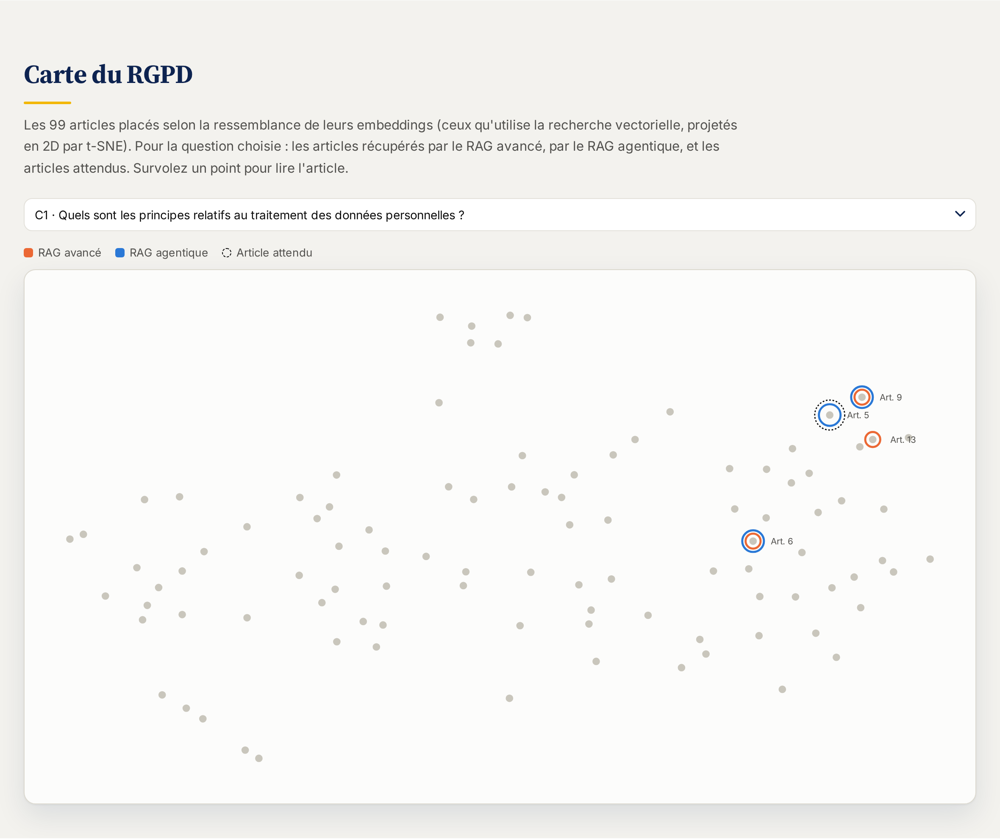
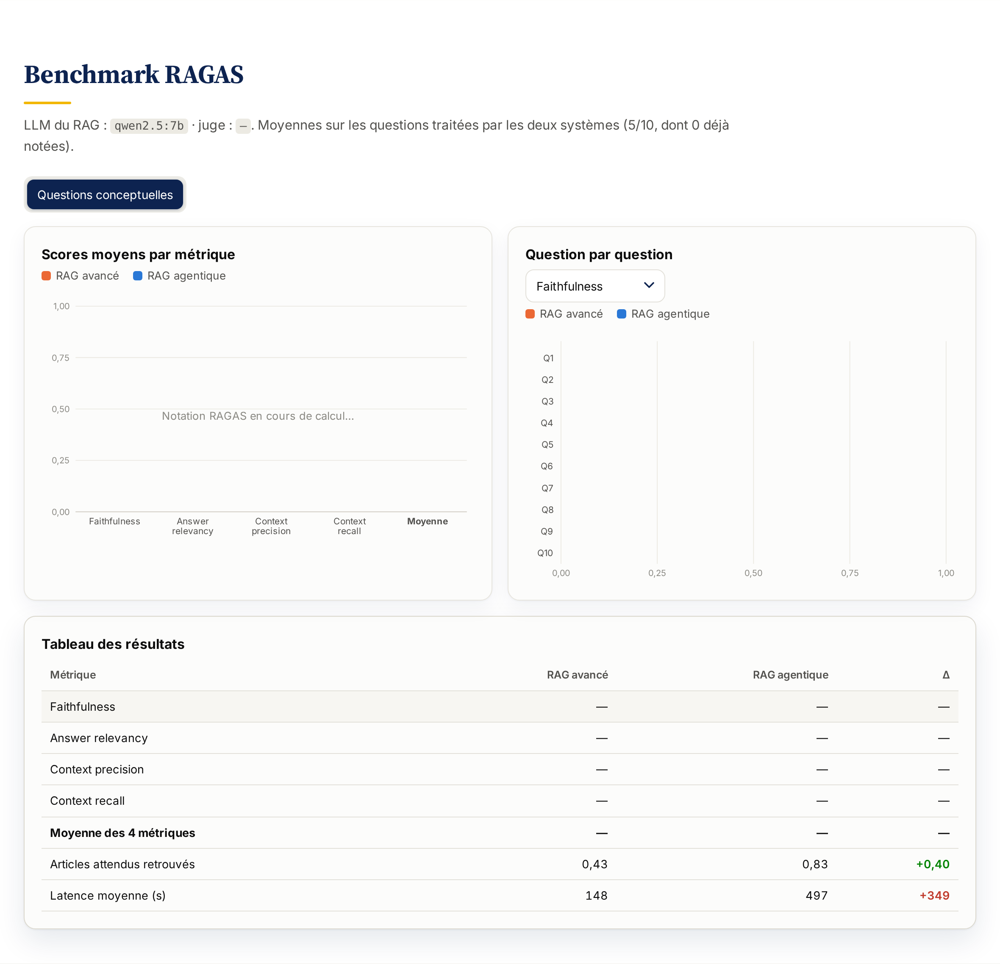
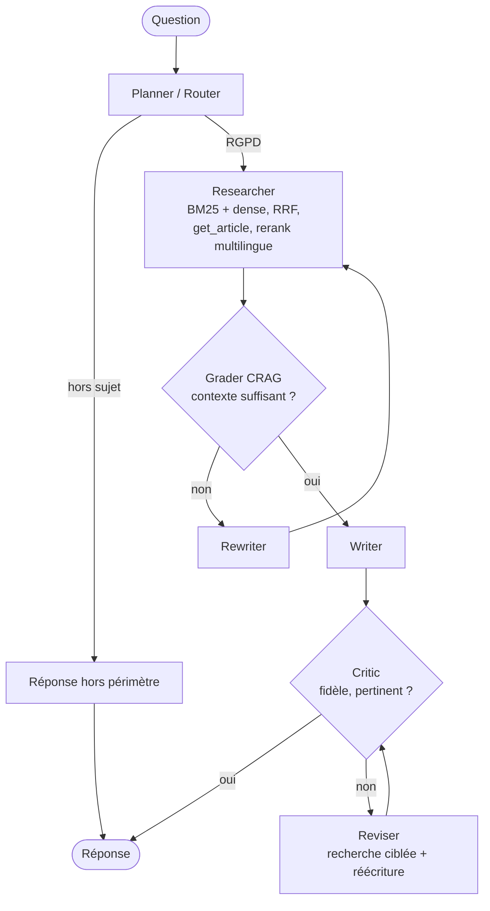

# RAG agentique · RGPD

[](https://github.com/berullekkb/rag-agentique-rgpd/actions/workflows/pages.yml)

**Site interactif : [berullekkb.github.io/rag-agentique-rgpd](https://berullekkb.github.io/rag-agentique-rgpd/)**
(graphe des agents rejouable, comparateur question par question, carte du RGPD, benchmark RAGAS).

<table>
  <tr>
    <td width="50%"><a href="https://berullekkb.github.io/rag-agentique-rgpd/#agents"></a></td>
    <td width="50%"><a href="https://berullekkb.github.io/rag-agentique-rgpd/#comparateur"></a></td>
  </tr>
  <tr>
    <td><b>Graphe des agents</b> : les 7 agents LangGraph, leurs boucles (CRAG, Reflexion) et le parcours réel d'une question rejoué étape par étape.</td>
    <td><b>Comparateur</b> : pour une même question, les articles donnés au LLM (✓ = article attendu), la réponse et les 4 scores RAGAS de chaque système.</td>
  </tr>
  <tr>
    <td><a href="https://berullekkb.github.io/rag-agentique-rgpd/#carte"></a></td>
    <td><a href="https://berullekkb.github.io/rag-agentique-rgpd/#benchmark"></a></td>
  </tr>
  <tr>
    <td><b>Carte du RGPD</b> : les 99 articles placés selon leurs embeddings ; on voit où cherche chaque système et où se trouve la bonne réponse.</td>
    <td><b>Benchmark RAGAS</b> : faithfulness, answer relevancy, context precision et context recall, en moyenne et question par question.</td>
  </tr>
</table>

Un assistant qui répond aux
questions sur le **RGPD** (règlement UE 2016/679) en s'appuyant **uniquement** sur le
texte du règlement, et la démonstration qu'une **orchestration agentique multi-agents**
fait mieux qu'un RAG avancé linéaire.

- **Corpus** : texte officiel du RGPD (EUR-Lex), 11 chapitres, 99 articles.
- **Deux systèmes** : un RAG avancé (multi-query, parent/child, reranking) et un RAG
  agentique de 7 agents LangGraph (planification, correction CRAG, réflexion).
- **100 % local** : LLM `qwen2.5:7b` et juge `qwen2.5:14b` via **Ollama**, aucune clé API.
- **Évaluation** : RAGAS sur 2 jeux de 10 questions, même LLM et même juge pour les deux systèmes.

## Résultats

<!-- RESULTATS:START -->
**Résultats intermédiaires** (calcul en cours sur le poste local, 5/10 questions
traitées par les deux systèmes, notation RAGAS à venir) :

- **Articles attendus retrouvés** : 43 % pour le RAG avancé contre **83 %** pour le
  RAG agentique (part des articles cités par la réponse de référence qui sont donnés au LLM).
- Exemple : à « Quels sont les principes relatifs au traitement des données personnelles ? »,
  la baseline répond avec l'article 6 (licéité) ; l'agentique, après une boucle CRAG
  (le Grader juge le contexte insuffisant, le Rewriter reformule), récupère l'**article 5**
  et cite les bons principes.

Le tableau RAGAS complet et les captures seront mis à jour à la fin du calcul.
<!-- RESULTATS:END -->

## Pourquoi un RAG agentique ? Diagnostic de la baseline

Le RAG avancé de départ (`backend/app/services/retriever.py`, `pipeline.py`) :

```
question → multi-query (4 variantes) → top-6 chunks / variante → articles parents
         → rerank cross-encoder (top-3) → prompt RGPD en 5 sections → réponse
```

Les résultats question par question montrent cinq faiblesses :

1. **Les titres d'articles ne sont pas indexés.** À « Quels sont les principes relatifs
   au traitement… ? », la baseline renvoie les articles 6, 9 et 13 mais pas
   l'**article 5**, dont c'est exactement le titre.
2. **Reranker anglais** (`ms-marco-MiniLM-L-6-v2`) sur un texte juridique français.
3. **Top-3 fixe** : les questions transversales (droits art. 15 à 21, transferts art.
   44 à 49, DPO art. 37 à 39) demandent plus de 3 articles.
4. **Gabarit en 5 sections** : « Points de vigilance » et « Recommandation » poussent le
   LLM à ajouter des conseils absents du contexte, ce qui fait baisser la faithfulness.
5. **Aucune boucle** : une mauvaise recherche ou une réponse infidèle n'est ni détectée
   ni corrigée.

## Le RAG agentique



| Agent | Rôle | Technique | Métrique visée |
|---|---|---|---|
| Planner / Router | route la question, la décompose, propose des articles | query decomposition | recall |
| Researcher | BM25 + vectoriel (fusion RRF), lecture d'un article, reranker multilingue | outils | recall, precision |
| Grader | garde les articles utiles, dit s'il en manque | Corrective RAG (Yan et al., 2024) | precision |
| Rewriter | reformule à partir de ce qui manque (1 boucle max) | boucle CRAG | recall |
| Writer | premier jet, **même prompt que la baseline** | — | — |
| Critic | affirmations non fondées, manques, digressions | Reflection, Self-RAG (Asai et al., 2023) | faithfulness, relevancy |
| Reviser | recherche ciblée puis réécriture (2 révisions max) | Reflexion (Shinn et al., 2023) | faithfulness |

Chaque agent produit une **sortie structurée** (schéma Pydantic converti en JSON Schema
et imposé par Ollama). Si le modèle local renvoie un JSON invalide, l'agent réessaie
puis applique un repli déterministe. Détails : [`RAG_AGENTIQUE.md`](RAG_AGENTIQUE.md).

## Protocole d'évaluation

1. **Même LLM** (`qwen2.5:7b`), même index ChromaDB, mêmes embeddings
   (`paraphrase-multilingual-MiniLM-L12-v2`) pour les deux systèmes.
2. **Même premier jet** : le Writer agentique utilise le prompt de la baseline ; l'écart
   mesure l'orchestration.
3. **Même juge** : `qwen2.5:14b`, température 0, plus gros que le modèle évalué.
4. **4 métriques RAGAS** + une mesure objective sans LLM : la part des articles attendus
   (cités par la réponse de référence) effectivement retrouvés.
5. Script **reprenable** (`evaluation/evaluation_comparative.py`) : générations et notes
   sont sauvegardées au fil de l'eau.

## Organisation du dépôt

```
rag-agentique-rgpd/
├── backend/                    API FastAPI + pipelines RAG
│   ├── app/services/retriever.py, pipeline.py   RAG avancé (baseline)
│   ├── app/services/agentic/                    RAG agentique LangGraph
│   │   ├── graph.py     graphe et agents
│   │   ├── prompts.py   prompts + schémas de sortie
│   │   └── tools.py     BM25 + dense (RRF), get_article, rerank
│   ├── app/services/llm.py      Ollama (défaut), Mistral, Gemini
│   └── data/                    texte du RGPD (HTML) + index ChromaDB (généré)
├── evaluation/
│   ├── evaluation_comparative.py   baseline vs agentique (RAGAS, reprenable)
│   ├── gold_set.json, gold_set2.json
│   └── results/                    générations, notes, comparaisons
├── docs/                       site interactif (GitHub Pages)
├── scripts/
│   ├── export_site_data.py     résultats → docs/data/*.json
│   └── capture_site.py         captures du README
├── rag-frontend/               interface de chat React (mode « RAG Agentique »)
├── scripts_windows/            installation, évaluation (double-clic)
└── tests/test_site.py          vérification des données avant publication
```

## Lancer le projet

Prérequis : Python 3.11+, [Ollama](https://ollama.com/download), Node 18+ (frontend).

```bash
ollama pull qwen2.5:7b          # LLM du RAG
ollama pull qwen2.5:14b         # juge RAGAS
python -m venv venv && venv\Scripts\activate
pip install -r requirements.txt

cd backend
python scripts/build_index.py   # première fois : index ChromaDB
python run.py                   # API → http://localhost:8000/docs
```

- API : `POST /query` avec `"mode": "agentic"` (réponse + `trace` des agents) ou
  `"mode": "adaptive"` (baseline).
- Frontend : `cd rag-frontend && npm install && npm run dev`.
- Évaluation : `python evaluation/evaluation_comparative.py --gold gold_set.json gold_set2.json`
  (ou `scripts_windows\2_evaluer.bat`), puis `python scripts/export_site_data.py`.

Configuration facultative dans `.env` : `LLM_MODEL`, `JUDGE_MODEL`, `LLM_PROVIDER`
(`ollama` par défaut, `mistral` ou `google` avec clé API).

## Limites

- 2 × 10 questions : un écart sur une question isolée est bruité ; on lit les moyennes.
- Juge local de 14B : moins fiable qu'un grand modèle commercial, mais identique pour les deux systèmes.
- Les outils du Researcher (BM25, reranker multilingue) améliorent aussi la recherche en eux-mêmes.
- L'agentique coûte plus cher : 6 à 9 appels au LLM par question contre 2.
- Le corpus se limite au texte du RGPD (pas de jurisprudence ni de lignes directrices CNIL).

## Auteur

Berulle Kamdem. Le RAG avancé de départ a été réalisé en équipe.
